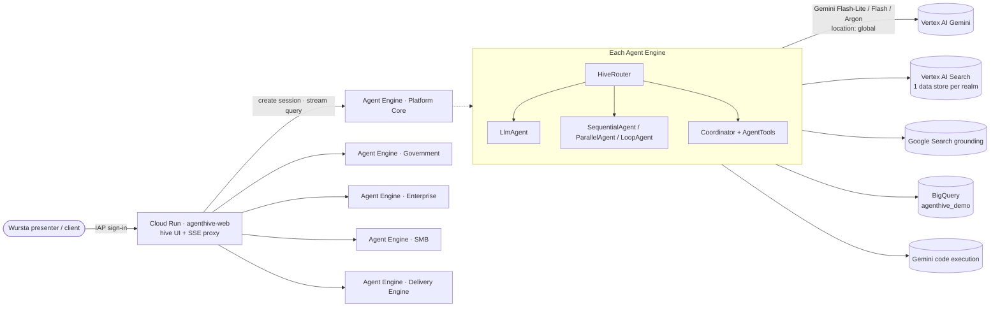

# Architecture

## Decisions

| Decision | Why |
|---|---|
| **One engine per realm, router inside** | Realms deploy and scale independently; ~20 agents share one warm container instead of 90 cold ones. Sessions are pinned to an agent, so the UI talks to "an agent", not to the router. |
| **Catalog-driven factory** | Agents are data. The UI, the deployed agents and the tests all read the same YAML, so what you see in the hive is what runs. |
| **Instruction providers** | Instructions are callables: they bypass ADK `{var}` templating (safe for JSON/code examples) and fill `{{output_key}}` from session state for pipeline steps. |
| **Cheapest model tier that works** | Flash-Lite for skills and routing, Flash by default, Argon reserved for coordinator/architecture/legal-risk reasoning. Tiers are env-overridable. |
| **Gemini on `global`** | Flash, Flash-Lite and Argon are served from the global endpoint; the model client is pinned there while Agent Engine runs in the region. |
| **Simulated side effects** | Tools that would send, create or move things return `simulated: true`. Demos are safe to run in front of clients. |
| **Synthetic data only** | Public repository; fictional organisations and records; client work is described generically. |
| **IAP in front of Cloud Run** | Only signed-in members of the allowed domain can run demos; a per-user rate limit caps Gemini spend. |

## Known follow-ups

- ADK 2.x marks `SequentialAgent`/`ParallelAgent`/`LoopAgent` as deprecated in favour of `Workflow`, which cannot yet
  be a sub-agent of an agent tree; migrate when ADK supports it.
- Register selected agents in Gemini Enterprise (one `adkAgentDefinition` per engine, `@code` routing).
- GitHub Actions deploy via Workload Identity Federation (CI currently runs the offline tests).
